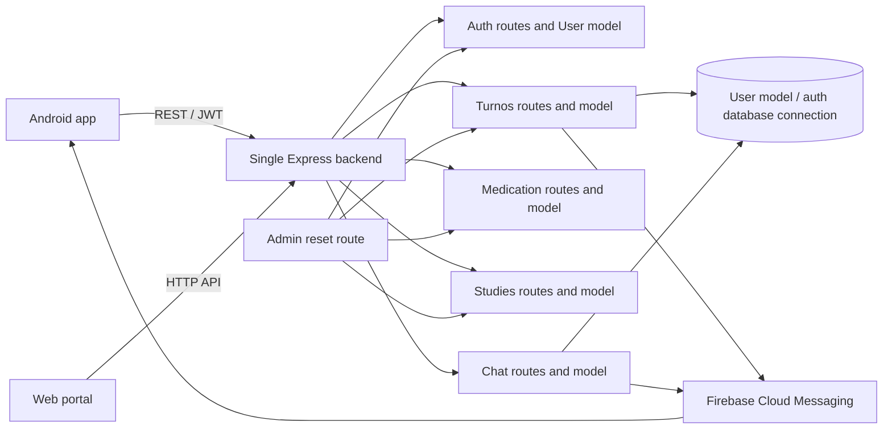
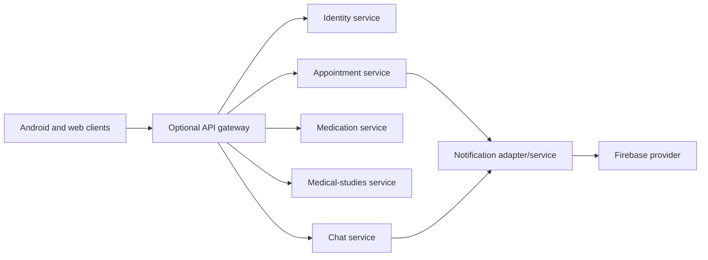

# Dependency Map — Salud Activa

## Current runtime

All backend route modules run in one Node.js process. Domain-specific Mongoose connections
are configured in `backend/config/dbConnections.js`, while routes still have direct
cross-module imports for user notification data and administrative resets.

## Target if extraction is approved

This is a **candidate topology**, not an implemented deployment. A broker is intentionally
not drawn: it should be added only after an approved event-driven use case and operational
design exist.

## Dependency review rules

- Keep dependencies directed; do not create cycles between domain owners.
- Prefer identity tokens/claims for authentication context; avoid synchronous profile lookups
  on every internal call unless a specific authorization requirement demands it.
- Define timeouts, retries, idempotency, and user-visible failure behavior for every remote call.
- Update this map when source imports, deployment units, API contracts, or data ownership change.
